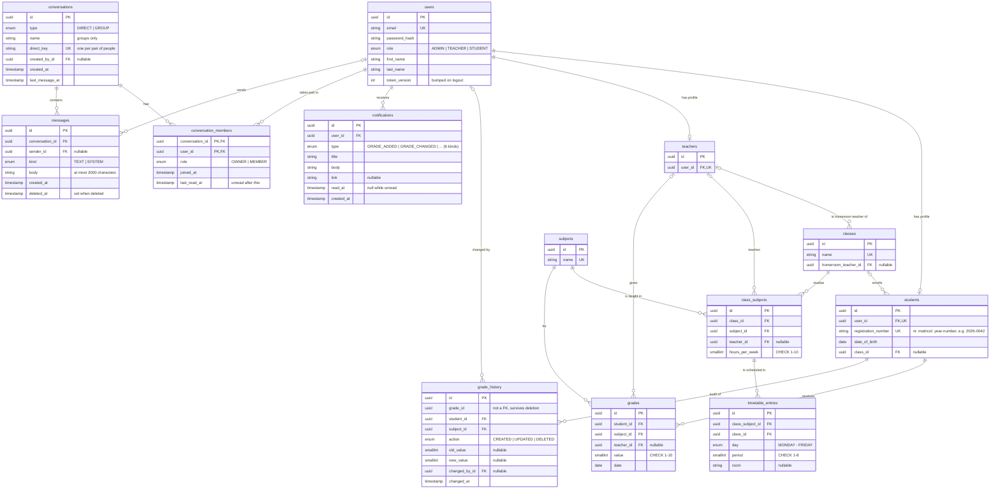

# School Management System

A full-stack web application for managing students, teachers, classes and grades, with role-based access for **Administrators**, **Teachers** and **Students**.

> Work in progress. This README grows with every feature.

## Tech stack

| Layer    | Technology                                                                                                 |
| -------- | ---------------------------------------------------------------------------------------------------------- |
| Backend  | NestJS 11, TypeScript (strict), Socket.IO (live notifications and chat), event emitter (domain events)     |
| Frontend | React 19, Vite, TypeScript, Tailwind CSS 4, shadcn/ui, React Router, TanStack Query, React Hook Form + Zod |
| Database | PostgreSQL 16 (Docker), Prisma 7 ORM                                                                       |
| Tooling  | ESLint + Prettier + Jest (API), Oxlint + Prettier + Vitest + Testing Library (web)                         |

## Project structure

```
.
├── backend/             NestJS REST API (+ Dockerfile)
│   ├── prisma/          Schema, migrations and seed
│   └── src/             Feature modules (auth, students, teachers, classes, ...)
├── frontend/            React single-page app (+ Dockerfile, nginx.conf)
│   └── src/             api (typed client), auth, components, features, pages
├── docs/                Schema picture, OpenAPI file, Bruno and Postman collections
├── docker-compose.yml   The whole stack, or only PostgreSQL for local development
└── README.md
```

## Prerequisites

- Docker Desktop
- Node.js 20+ (developed on Node 24 LTS), only for running without Docker

## Quick start with Docker

One command builds and starts everything: database, migrations with demo data, API and web app.

```bash
docker compose up --build
```

Open **http://localhost:8080** and log in with one of the [test accounts](#test-credentials). The API docs are at http://localhost:8080/api/docs.

| Service    | What it does                                                                                                                 |
| ---------- | ---------------------------------------------------------------------------------------------------------------------------- |
| `postgres` | PostgreSQL 16, data kept in the `postgres-data` volume                                                                       |
| `migrate`  | Runs once: applies the migrations, then seeds the demo data **only if the database is empty**, so restarts keep your changes |
| `api`      | The NestJS API (port 3000), started once the migrations succeeded; production dependencies only, runs as a non-root user     |
| `web`      | nginx (port 8080) serving the built React app and forwarding `/api` (REST and WebSockets) to the API                         |

The services start in order: the migrations wait for a healthy database, the API for the migrations to succeed and the web app for a healthy API. The defaults work out of the box; to change ports or the JWT secret, copy `.env.example` to `.env`. The API container also reads `backend/.env` if it exists (that's where the AI keys go, see [Reading grades from photos](#reading-grades-from-photos-of-tests-ai)). To start over with fresh demo data: `docker compose down -v`.

## Local development (hot reload)

Only needed if you want to **change the code**: the Docker setup above runs the built app, so every change would need a rebuild. Here only the database runs in Docker, while the API and the web app run with hot reload, so changes show up instantly.

**1. Start the database**

```bash
docker compose up -d postgres
```

**2. Set up and start the API** (http://localhost:3000/api)

```bash
cd backend
cp .env.example .env
npm install          # also generates the Prisma client
npm run db:migrate   # creates the tables
npm run db:seed      # fills the database with demo data
npm run start:dev
```

**3. Start the frontend** (http://localhost:5173)

```bash
cd frontend
npm install
npm run dev
```

In development, Vite proxies every `/api` request to the backend, so the frontend and the API behave as if they share the same origin.

## Test credentials

All seeded accounts use the password **`Password123!`**.

| Role          | Email                 | Notes                                                            |
| ------------- | --------------------- | ---------------------------------------------------------------- |
| Administrator | `admin@school.test`   | Full access                                                      |
| Teacher       | `teacher@school.test` | Teaches Mathematics in 9A, 9B and 10A, homeroom teacher of 9A    |
| Student       | `student@school.test` | Enrolled in 9A, has grades in every subject and a full timetable |

The seed also creates 9 more teachers (each teaching one subject), 60 more students (2 of them not assigned to any class), the teaching assignments of every class, a conflict-free weekly timetable and about 1,500 grades. The data is generated with a fixed seed, so it is identical on every run. Running `npm run db:seed` again resets the database to this state.

## Database

A full-size picture of the schema is in [`docs/database-schema.png`](docs/database-schema.png).



**Design decisions**

- **One `users` table for authentication, separate profile tables per role.** Login, password hashing and role checks live in one place, while student- and teacher-specific data stays in its own table.
- **Subjects are a table, not free text.** This keeps names consistent ("Math" vs "Mathematics") so per-subject averages are correct. It also makes the Excel import reliable.
- **Homeroom teacher vs. subject teachers.** The requirement "each class has one teacher" is modelled as the class's homeroom teacher (`classes.homeroom_teacher_id`, _diriginte_). Who teaches what lives in `class_subjects`: one row per class and subject, with the teacher and the number of hours per week. This is what a real school timetable is built from.
- **Grading permissions follow the teaching assignments.** A teacher can grade a student only in a subject they teach in that student's class. `grades.teacher_id` records who gave the grade, so a teacher can only edit their own grades.
- **The timetable is protected by the database, not only by the API.** `timetable_entries` has a unique constraint on `(class_id, day, period)`, so a class can never have two lessons at the same time. `class_id` is a copy of the class from `class_subjects`, kept consistent by a composite foreign key on `(class_subject_id, class_id)`. Teacher double-booking depends on who teaches the subject, which can change, so it is checked in the service layer.
- **UUID primary keys**, so IDs in URLs can't be guessed or enumerated.
- **Value ranges are enforced twice:** in the API validation and with database `CHECK` constraints (grade 1-10, period 1-8, hours per week 1-10).
- **Averages are computed, never stored**, so they can never get out of sync with the grades. As in Romanian schools, each subject gets its own average, and the overall average is the mean of the subject averages.
- **Every grade change is audited** in `grade_history`, written in the same transaction as the change (see [Grades and averages](#grades-and-averages)).
- **A direct conversation exists once per pair of people.** `conversations.direct_key` holds the two user ids sorted and joined, with a unique index, so two people opening a chat at the same moment still get one conversation. A `CHECK` makes a group have a name and a direct conversation a key.
- **Unread counts are computed, not stored.** Each member has a `last_read_at`; unread messages are the ones from others after it, so a counter can never drift.
- **Notifications are stored with their text**, written when the event happens, so they read the same later even if a subject is renamed or a lesson moves again.
- **The timetable uses periods (1st to 8th lesson), not clock times.** That is how school timetables are read, and it keeps the overlap rules simple.

**What happens on delete**

| Deleted | Effect                                                                                                                         |
| ------- | ------------------------------------------------------------------------------------------------------------------------------ |
| Student | Their grades, grade history, notifications and chat memberships are deleted; their messages stay, shown as from a deleted user |
| Teacher | Their classes lose the homeroom teacher, their subjects become vacant, grades are kept                                         |
| Class   | Its students become unassigned, its teaching assignments and timetable are deleted                                             |
| Subject | Blocked while it is taught in a class or has grades (`409 Conflict`)                                                           |

## API documentation

- **Swagger UI:** http://localhost:3000/api/docs (raw OpenAPI JSON at `/api/docs-json`). Log in with `POST /api/auth/login`, click **Authorize** and paste the `accessToken`.
- **Bruno:** open the folder [`docs/bruno`](docs/bruno) with **Open Collection**. Run one of the **Login as ...** requests first: it saves the token, and every other request uses it automatically.
- **OpenAPI file:** [`docs/openapi.json`](docs/openapi.json), exported with `npm run openapi` in `backend` (no database needed).
- **Postman:** import [`docs/postman/school-management.postman_collection.json`](docs/postman/school-management.postman_collection.json). It works the same way.

### Endpoints

All endpoints are under `/api`. "Teacher (own)" means a teacher only sees the classes they teach or are homeroom teacher of; any other class returns `403`.

| Method | Path                                      | Access                                    | Description                                                                    |
| ------ | ----------------------------------------- | ----------------------------------------- | ------------------------------------------------------------------------------ |
| GET    | `/health`                                 | Public                                    | API and database status                                                        |
| POST   | `/auth/login`                             | Public                                    | Log in, returns a JWT (max 5 attempts/min)                                     |
| GET    | `/auth/me`                                | Any logged-in                             | The current user with their role and profile                                   |
| POST   | `/auth/logout`                            | Any logged-in                             | Log out: revokes every token of the user (all devices)                         |
| GET    | `/students`                               | Admin                                     | List students (paginated, search by name, email or reg. no., class filter)     |
| POST   | `/students`                               | Admin                                     | Create a student account, optionally in a class                                |
| GET    | `/students/:id`                           | Admin                                     | Student details                                                                |
| PATCH  | `/students/:id`                           | Admin                                     | Update a student, move or unassign, reset password                             |
| DELETE | `/students/:id`                           | Admin                                     | Delete a student and their grades                                              |
| GET    | `/teachers`                               | Admin                                     | List teachers (paginated, search)                                              |
| GET    | `/teachers/me`                            | Teacher                                   | My profile, homeroom classes and teaching assignments                          |
| POST   | `/teachers`                               | Admin                                     | Create a teacher account                                                       |
| GET    | `/teachers/:id`                           | Admin                                     | Teacher details, homeroom classes and subjects                                 |
| PATCH  | `/teachers/:id`                           | Admin                                     | Update a teacher, reset password                                               |
| DELETE | `/teachers/:id`                           | Admin                                     | Delete a teacher (their grades are kept)                                       |
| GET    | `/classes`                                | Admin, Teacher (own)                      | List classes (paginated, natural order 9A → 12A)                               |
| POST   | `/classes`                                | Admin                                     | Create a class                                                                 |
| GET    | `/classes/:id`                            | Admin, Teacher (own), Student (own class) | Class details with subjects and teachers                                       |
| PATCH  | `/classes/:id`                            | Admin                                     | Rename, change homeroom teacher                                                |
| DELETE | `/classes/:id`                            | Admin                                     | Delete a class (students become unassigned)                                    |
| GET    | `/classes/:id/students`                   | Admin, Teacher (own)                      | Students enrolled in the class                                                 |
| POST   | `/classes/:id/students`                   | Admin                                     | Assign several students to the class at once                                   |
| DELETE | `/classes/:id/students/:studentId`        | Admin                                     | Remove a student from the class                                                |
| GET    | `/subjects`                               | Any logged-in                             | List subjects                                                                  |
| GET    | `/subjects/:id`                           | Any logged-in                             | Subject details                                                                |
| POST   | `/subjects`                               | Admin                                     | Create a subject                                                               |
| PATCH  | `/subjects/:id`                           | Admin                                     | Rename a subject                                                               |
| DELETE | `/subjects/:id`                           | Admin                                     | Delete a subject (blocked while in use: `409`)                                 |
| POST   | `/classes/:id/subjects`                   | Admin                                     | Add a subject to a class, with its teacher and weekly hours                    |
| PATCH  | `/class-subjects/:id`                     | Admin                                     | Change the teacher or the weekly hours; can remove extra lessons at once       |
| DELETE | `/class-subjects/:id`                     | Admin                                     | Remove a subject from a class with its lessons (grades are kept)               |
| GET    | `/classes/:id/timetable`                  | Admin, Teacher (own), Student (own class) | Weekly timetable of a class                                                    |
| GET    | `/teachers/:id/timetable`                 | Admin                                     | Weekly timetable of a teacher                                                  |
| GET    | `/timetable/me`                           | Teacher, Student                          | My lessons (teacher) or my class timetable (student)                           |
| POST   | `/classes/:id/timetable`                  | Admin                                     | Add a lesson; can replace the lesson in that slot or add a weekly hour         |
| PATCH  | `/timetable-entries/:id`                  | Admin                                     | Move a lesson to another slot or room; can swap or replace                     |
| GET    | `/class-subjects/:id/free-slots`          | Admin                                     | Slots where both the class and the teacher are free                            |
| DELETE | `/timetable-entries/:id`                  | Admin                                     | Remove a lesson                                                                |
| GET    | `/grades`                                 | Admin, Teacher (own)                      | List grades (paginated, filter by class, subject, student)                     |
| POST   | `/grades`                                 | Admin, Teacher (own)                      | Give a grade (teachers: only their subject in that class)                      |
| PATCH  | `/grades/:id`                             | Admin, Teacher (own grades)               | Change the value or date of a grade                                            |
| DELETE | `/grades/:id`                             | Admin, Teacher (own grades)               | Delete a grade (kept in the history)                                           |
| GET    | `/grades/:id/history`                     | Admin                                     | Who created, changed or deleted a grade, and when                              |
| GET    | `/grades/me`                              | Student                                   | My grades, subject averages and overall average                                |
| GET    | `/students/:id/grades`                    | Admin, Teacher (own)                      | A student's grades and averages                                                |
| GET    | `/classes/:id/gradebook?subjectId=`       | Admin, subject teacher, homeroom teacher  | All students of a class with their grades in one subject                       |
| POST   | `/classes/:id/grades`                     | Admin, subject teacher                    | Give or replace many grades at once, all or none (scans, Excel import)         |
| POST   | `/classes/:id/grade-scans`                | Admin, subject teacher                    | Read student and grade from photos of tests with AI (saves nothing)            |
| POST   | `/grades/batch`                           | Admin, subject teacher                    | Give or replace grades of students in several classes, all or none             |
| GET    | `/grade-imports/options`                  | Admin, Teacher                            | Subjects and classes the user can import grades for                            |
| GET    | `/grade-imports/template`                 | Admin, subject teacher                    | Excel template for one class or all classes of a subject                       |
| POST   | `/grade-imports`                          | Admin, subject teacher                    | Read grades from a filled template or a CSV (saves nothing)                    |
| GET    | `/notifications`                          | Any logged-in                             | My notifications, newest first (paginated, `unread=true` filter)               |
| GET    | `/notifications/unread-count`             | Any logged-in                             | How many are unread                                                            |
| PATCH  | `/notifications/:id/read`                 | Any logged-in (own only)                  | Mark one as read                                                               |
| PATCH  | `/notifications/read-all`                 | Any logged-in                             | Mark all as read                                                               |
| GET    | `/chat/contacts`                          | Teacher, Student                          | People I can write to (search)                                                 |
| GET    | `/chat/conversations`                     | Teacher, Student                          | My conversations with last message and unread count                            |
| GET    | `/chat/unread-count`                      | Teacher, Student                          | Unread messages in all my conversations                                        |
| POST   | `/chat/conversations/direct`              | Teacher, Student                          | Open the direct conversation with someone (existing or new)                    |
| POST   | `/chat/conversations/group`               | Teacher                                   | Create a group                                                                 |
| GET    | `/chat/conversations/:id`                 | Members                                   | A conversation with its members                                                |
| PATCH  | `/chat/conversations/:id`                 | Group creator                             | Rename a group                                                                 |
| DELETE | `/chat/conversations/:id`                 | Group creator                             | Delete a group                                                                 |
| POST   | `/chat/conversations/:id/members`         | Group creator                             | Add people                                                                     |
| DELETE | `/chat/conversations/:id/members/:userId` | Group creator, or the member (leave)      | Remove someone, or leave                                                       |
| GET    | `/chat/conversations/:id/messages`        | Members                                   | Messages, newest page first (`before`, `limit`)                                |
| POST   | `/chat/conversations/:id/messages`        | Members                                   | Send a message (30 a minute)                                                   |
| POST   | `/chat/conversations/:id/read`            | Members                                   | Mark as read                                                                   |
| DELETE | `/chat/messages/:id`                      | The sender                                | Delete a message                                                               |
| WS     | `/api/socket.io`                          | Teacher, Student (token in handshake)     | Live notifications and chat (`notification`, `chat:message`, `chat:typing`...) |

### Conventions

- **Pagination:** list endpoints accept `page`, `pageSize` (max 100), `sort`, `order` (`asc`/`desc`) and `search`, and return `{ data, meta: { page, pageSize, total, totalPages } }`.
- **Errors** always have the same shape:

  ```json
  {
    "statusCode": 404,
    "error": "Not Found",
    "message": "Student not found",
    "path": "/api/students/0b39a733-7b2b-45e6-9d19-7938ad3af0b6",
    "timestamp": "2026-10-20T10:00:00.000Z"
  }
  ```

  `message` is a list for validation errors. Status codes: `400` invalid input (including malformed ids), `401` missing or invalid token, `403` not allowed, `404` not found, `409` conflict (duplicate email or name, resource still in use; timetable conflicts also carry a `conflict` object, see below), `429` too many login attempts.

## Timetable rules

Every lesson added or moved is checked, and each rule has a clear `409` message:

| Rule                                                                                | Example message                                                       |
| ----------------------------------------------------------------------------------- | --------------------------------------------------------------------- |
| A class has at most one lesson per slot                                             | `9A already has Physics on Monday, period 2`                          |
| A teacher can't be in two classes at once                                           | `Mihai Ionescu already teaches 10A on Monday, period 2`               |
| A subject can't exceed its weekly hours                                             | `Mathematics already has 4/4 hours scheduled in 9A`                   |
| Weekly hours can't drop below what is scheduled                                     | `Mathematics has 5 lessons in the 9A timetable. Remove 1 of them ...` |
| Changing a subject's teacher requires the new teacher to be free at all its lessons | (same as the teacher rule)                                            |

### Resolving a conflict instead of just refusing

A `409` from the timetable is not a dead end. It carries a `conflict` object (`type`, the lessons in the way, the slot), and the admin page turns it into a dialog with the choices that make sense for that case. Every choice is a single request, so it is applied atomically or not at all:

| Conflict                                 | Choices in the dialog                                                                                   | How the API does it                                    |
| ---------------------------------------- | ------------------------------------------------------------------------------------------------------- | ------------------------------------------------------ |
| `CLASS_SLOT_TAKEN` (moving a lesson)     | Swap the two lessons · replace the lesson in that slot · pick another free slot                         | `swap: true` · `replaceLessonId` · free slots endpoint |
| `CLASS_SLOT_TAKEN` (adding a lesson)     | Replace the lesson in that slot · pick another free slot                                                | `replaceLessonId`                                      |
| `TEACHER_BUSY`                           | Pick a slot where both the class and the teacher are free. Another class's lesson is never overwritten. | `GET /class-subjects/:id/free-slots`                   |
| `WEEKLY_HOURS_FULL`                      | Make it one more hour a week · move one of the existing lessons here instead                            | `increaseHours: true` · `PATCH` the chosen lesson      |
| `HOURS_BELOW_SCHEDULED` (lowering hours) | Tick which lessons to remove; saved together with the new hours                                         | `removeLessonIds`                                      |

If the timetable changed in the meantime (someone else took the slot), the retry returns the new conflict and the dialog shows it, instead of overwriting something the admin hasn't seen.

The checks and the write run in one **serializable** transaction, so two admins editing the timetable at the same moment can't both pass the checks and create a conflict; one of them gets a `409` and can retry. The class rule is also guaranteed by a unique index in the database.

## Frontend

**Typed end to end.** The API client is generated from the backend's OpenAPI document (`openapi-typescript` + `openapi-fetch`). Every path, parameter, request body and response in the React app is checked against the real API, so a breaking change in the backend fails `npm run build` in the frontend. After changing the API, run `npm run openapi` in `backend` and then `npm run api:types` in `frontend` to refresh `src/api/schema.d.ts`. Neither needs the API or the database to be running.

**Pages per role**

| Role    | Pages                                                                                                                                                                                                     |
| ------- | --------------------------------------------------------------------------------------------------------------------------------------------------------------------------------------------------------- |
| Admin   | Dashboard, students, teachers, classes (students, subjects, timetable editor with conflict resolution, gradebook with test scanning and Excel import), subjects, all grades with history                  |
| Teacher | Dashboard (today's lessons, classes, latest grades), my classes, class page (gradebook, students, timetable), **scan tests with AI**, **import grades from Excel**, a student's report card, my timetable |
| Student | Dashboard (today's lessons, latest grades, profile), my grades (report card, averages by subject), my class (homeroom teacher, subjects and teachers), my timetable                                       |

Teachers and students also have a **notification bell** in the header and a **Notifications** page (see [Notifications](#notifications-live)). They also have **Messages** (see [Chat](#chat-direct-messages-and-groups)).

The gradebook is one component shared by the admin and the teacher. A teacher sees only their own subjects (the homeroom teacher sees every subject of their class, read-only except their own), adds grades only in their subjects and changes only the grades they gave. The API enforces the same rules; the UI only hides what would be refused.

**Authentication in the browser**

- The login page has one-click **demo account** buttons for the three seeded roles.
- The JWT is stored in `localStorage`, so a page refresh keeps you logged in. The trade-off: a script injected into the page (XSS) could read it. The exposure is limited because tokens expire after one hour and logout revokes them on the server. An httpOnly cookie would remove the risk (see "What I would do with more time").
- On startup the session is restored with `GET /auth/me`. If the API ever answers `401` (expired token, logout on another device, password reset), the app logs out and shows a message.
- Routes are guarded by role (`RequireAuth`): anonymous users go to the login page and come back afterwards, other roles see an "Access denied" page. This is only for user experience; the API enforces the same rules.

**Conventions:** server data goes through TanStack Query; every failed change shows the API's error message in a toast; forms use React Hook Form with Zod schemas that mirror the API validation.

## Grades and averages

**Who can do what**

- A teacher can grade a student only in a subject they teach **in that student's class** (from the teaching assignments). Anything else is `403` with a message such as `You don't teach Physics in 9A`.
- A teacher can change or delete only the grades **they gave**. The admin can manage every grade; a grade the admin gives is attributed to the subject's teacher, and the history records that the admin entered it.
- The homeroom teacher can see every subject of their class (gradebook, student reports) but still only grades their own subject.
- A student only sees their own grades.

**Averages, as in Romanian schools** (`src/grades/averages.ts`, fully unit-tested)

- Subject average: mean of the grades with two decimals, truncated, then rounded to a whole grade: `9.50` becomes `10`, `9.49` becomes `9`. Both values are returned (`average`, `roundedAverage`).
- Overall average: mean of the **rounded** subject averages, with two decimals, truncated. It is `null` until every subject has at least one grade.
- Minimum number of grades per subject: weekly hours + 1. Reports show `minimumGrades` and `hasMinimumGrades` for each subject.
- Averages are computed with integer arithmetic (hundredths), so floating point can never turn `9.5` into `9.4999`.

**Audit log**

Every grade change writes a row in `grade_history` (who, when, action, old and new value and date) **in the same transaction** as the change itself, so a grade can never change without a trace. The history references the grade by id without a foreign key, so it survives when the grade is deleted.

## Reading grades from photos of tests (AI)

A teacher grades a stack of paper tests, takes a photo of each one, and gets the grades into the gradebook without typing them.

1. In the gradebook, pick a subject and click **Scan tests**, then add the photos (one test per photo, up to 20). The browser shrinks each photo to 2000 px and turns it into a JPEG before upload, so a 5 MB phone photo becomes about 300 KB.
2. For each photo, an AI model with vision reads the name written on the test and the final grade. It gets the numbered list of the class's students to match the name against, never their ids or the file name, and must answer in a fixed JSON schema. Up to 4 photos are read in parallel.
3. The API **checks the answer instead of trusting it**: the answer must match the schema, the student number must exist, the name on the paper must fit that student (otherwise the confidence drops to low), names are compared without diacritics and in any order, and the grade must be 1–10. A grade with decimals is rounded like averages (7.50 → 8).
4. The teacher sees every photo next to what was read, with the confidence and notes ("grade crossed out and rewritten"), and can change the student or the grade, or leave a photo out. Saving is blocked while a row has no student, no grade, or the same student as another photo. If the student already has a grade in that subject on the same day, the row asks what to do (see [same-day grades](#a-grade-on-a-day-that-already-has-one)).
5. **Save** sends all the grades with `POST /classes/:id/grades`, in one transaction: all of them are saved, or none.

**Choosing the AI.** The reader is an interface (`TestReader`) with three implementations, picked by `AI_PROVIDER` (default `auto`):

| Provider         | Key                 | Default model      | Notes                                                                                                                         |
| ---------------- | ------------------- | ------------------ | ----------------------------------------------------------------------------------------------------------------------------- |
| Google Gemini    | `GEMINI_API_KEY`    | `gemini-3.8-flash` | Free tier ([get a key](https://aistudio.google.com/apikey)); on the free tier Google may use the data to improve its products |
| Anthropic Claude | `ANTHROPIC_API_KEY` | `claude-haiku-5-5` | Paid, a fraction of a cent per photo; data not used for training                                                              |
| Demo             | none                | —                  | Simulated results, clearly labelled in the page, so the flow works without any key                                            |

With `auto`, Gemini is used if its key is set, else Claude, else the demo. Both AI readers share the same prompt and the same answer schema (`readers/prompt.ts`), so they are interchangeable. For real student data I would use a paid tier, where the data is not used for training.

**When the AI is busy or rate-limited** (free tiers allow only a few requests per minute), a photo doesn't simply fail. The models form a chain (`ResilientTestReader`): `GEMINI_MODEL`, then `GEMINI_FALLBACK_MODELS`, then Claude if its key is set.

1. On a limit (`429`) or an outage (`5xx`, network error), the next model is tried right away. On the free tier every model has its own quota, so a second model usually answers.
2. A model that can't work (bad key, unknown model, answer not matching the schema) is skipped for that photo.
3. If every model is busy, it waits as long as the API asked (`Retry-After`, or Gemini's `retryDelay`), or 2 s, 4 s, 8 s… and tries again, for at most `AI_RETRY_SECONDS` (60) per photo.
4. Only `AI_CONCURRENCY` photos (2) are read at the same time, and the browser sends them 4 per request, so each request stays short and the page shows progress.
5. Photos that still fail are marked in the table, with a **Retry failed photos** button that sends only those again. The page says which model read a photo when it wasn't the main one.

**Privacy and limits.** Photos are only held in memory while they are read: they are not stored, and nothing is saved before the teacher confirms. Uploads are checked by their content (magic bytes), not by their name; scanning is limited to 10 requests per minute, and a teacher can only scan tests of a subject they teach.

**Try it.** Sample photos of graded Maths tests for class 9A are in [`docs/sample-tests`](docs/sample-tests), including a decimal grade and a corrected grade. Add a key to `backend/.env` (used both by `npm run start:dev` and by Docker), log in as `teacher@school.test` and open 9A → Gradebook → Mathematics → Scan tests.

**Code:** `backend/src/grade-scans`, `frontend/src/features/grade-scans`.

## Importing grades from Excel

For teachers who keep their marks in a spreadsheet, for one class or for all their classes at once.

1. Open **Import grades from Excel** (on _My classes_, on the admin _Grades_ page, or **Import from Excel** in a gradebook, which preselects its class). Pick the subject and one class or all of them, then **Download template**.
2. The `.xlsx` has one row per student: **Class**, **Reg. no.** (the registration number, _nr. matricol_), **Last name**, **First name**, an empty **Grade** column that only accepts whole numbers 1–10 and an optional **Date**. There are no ids in the file, hidden or not; a filter on the header shows one class at a time, and a second sheet explains how to fill it in.
3. Fill in the grades (rows without one are skipped) and upload the file. Your own sheet or a `.csv` also works; headers are recognised in English and Romanian (`Clasa`, `Nr. matricol`, `Nume`, `Prenume`, `Nota`, `Data`...), and dates as `2026-10-17`, `17.10.2026` or `17/10/2026`.
4. The API **reads, it doesn't save** (`POST /grade-imports`, max 2 MB and 500 rows) and matches each row to a student:
   - by **registration number**, which is unique in the school and doesn't change when a student moves class. If the name in the row is someone else's, the row is left for the teacher to pick, since either the number or the name is wrong;
   - without one, by **class and name** (any order, no diacritics; `9 a` is `9A`). If two students share a name, the note asks for the reg. no.

   It also rounds decimals like averages and explains every change in a note ("8.5 rounded to 9", "Class "11A" is not part of this import").

5. The review table is the same one as for scanned tests, with the students grouped by class in the picker. Save sends everything to `POST /grades/batch` in **one transaction**, even across classes: the teacher must teach the subject in every student's class, or nothing is saved.

**Registration numbers** (_numere matricole_) are the year the student was enrolled and their number among that year's enrollments: `2026-0042` is the 42nd student enrolled in 2026. They are unique in the school, never change (not even when a student moves class), and sort by year and then number. A new student gets the next number of the current year; if two are created at the same moment, the unique index rejects the second insert and it takes the following number. The seed numbers students by the year they started grade 9 (12A: `2023-…`, 9A: `2026-…`). The import also accepts them written as `2026-42`, `2026/42` or `42/2026`. They are shown in the student lists, the gradebook, the student pages and the student's own profile, and are searchable.

**Try it.** Log in as `teacher@school.test` (Mathematics in 9A, 9B and 10A), go to _My classes_ → **Import grades from Excel**, download the template for all 3 classes, type a few grades and upload it. Or upload [`docs/sample-grades/grades-9A.csv`](docs/sample-grades/grades-9A.csv) (Romanian headers, `;` separator). To see the same-day dialog, put the date of an existing grade (hover a grade in the gradebook) in the `Date` column.

### A grade on a day that already has one

Both the scan and the import pages check every row against the student's grades in that subject. If there is already one on the same date, the row shows _"Already has a 10 on 17 Oct 2026: choose what to do"_ and saving waits for a decision. The dialog lists all the student's grades in the subject with their dates (the same-day ones highlighted) and offers:

- **Add** it as another grade (two tests on the same day are possible);
- **Replace** one of the existing grades. Teachers can only replace grades they gave, admins any; the change is recorded in the grade history as `UPDATED`, with the old and new value;
- **Don't save** this row.

The API enforces the same rules (`replaceGradeId` must be a grade of that student and subject, and a teacher's own), so the dialog is a convenience, not the only check.

**Code:** `backend/src/grade-imports`, `frontend/src/features/grade-imports`, the shared review in `frontend/src/features/grades/review`.

## Notifications (live)

Students and teachers are told about what concerns them, as it happens: a toast pops up, the bell's counter goes up, and the page they are on refreshes its data (a student's dashboard shows the new grade without reloading).

| Who              | Is told when                                                                                                       | Example                                                               |
| ---------------- | ------------------------------------------------------------------------------------------------------------------ | --------------------------------------------------------------------- |
| Student          | They get a grade, or one of their grades is changed or removed (also from a test scan or an Excel import)          | _New grade in Mathematics: 9_                                         |
| Student          | Their class timetable changes: a lesson is added, moved, swapped, removed, changes room or gets a new teacher      | _Mathematics moved: Monday, period 1 → Tuesday, period 3._            |
| Teacher          | One of their own lessons is added, moved or removed (with the class's name)                                        | _Mathematics in 9A moved_                                             |
| Teacher          | They are given or lose a subject in a class, its weekly hours change, they become or stop being a homeroom teacher | _You teach Physics in 9A_                                             |
| Homeroom teacher | A student of their class gets a failing grade (under 5), or an average drops under 5 after a change                | _Andrei Georgescu got a 4 in Mathematics. Their average is now 6.33._ |

A change that touches many lessons (a swap, lowering the hours) is one notification listing the changes, not one per lesson. Nobody is told about their own action: the homeroom teacher who gives a 4 doesn't get an alert about it.

**How it works**

1. **Domain events.** The services that change data publish what happened after their transaction commits (`grades.changed`, `timetable.changed`, `assignments.changed`), with `@nestjs/event-emitter`. They don't know about notifications: the `notifications` module listens and decides who is told what (`notification-rules.listener.ts`). A failure there is logged and never undoes the change.
2. **Timetable changes are compared, not guessed.** The timetable service takes a snapshot of the class's lessons before and after the change, in the same serializable transaction, and a pure function (`diffTimetable`) finds what was added, removed, moved, changed room or got a new teacher. Every operation (swap, replace, lowering the hours, a new teacher) is described correctly without special cases.
3. **Saved, then pushed.** Notifications are saved in the `notifications` table, then sent over **Socket.IO** to every open tab of the user (each user has a room). Socket.IO runs under `/api/socket.io`, so the same nginx and Vite proxy rules serve it.
4. **Authenticated connections.** The browser sends its access token in the handshake, checked exactly like an HTTP request (`AccessTokenService`, shared with the guard): wrong or expired token, no connection. On logout the server closes the user's open connections.
5. **Nothing is missed.** After a reconnection (laptop asleep, network down) the app reloads the list, so a notification that arrived meanwhile shows up. Reading a notification in one tab updates the counter in the others.

The wording of every notification is in one file of pure functions (`messages.ts`), unit-tested like the timetable comparison. The seed leaves each student's two latest grades as unread notifications, so the bell isn't empty on the first login.

**Try it:** log in as `student@school.test` in one browser and as `teacher@school.test` in another (or a private window), then give the student a grade, or move one of 9A's lessons as `admin@school.test`.

**Code:** `backend/src/notifications`, `backend/src/events`, `frontend/src/features/notifications`.

## Chat (direct messages and groups)

Teachers and students have **Messages** in the menu, with a counter of unread messages. Admins manage the school and have no chat.

**Who can write to whom** (`ChatPolicyService`, checked by the API on every new conversation and group member):

| User    | Can write to                                                                          |
| ------- | ------------------------------------------------------------------------------------- |
| Teacher | Other teachers, and the students of the classes they teach or are homeroom teacher of |
| Student | Their teachers (subject and homeroom teachers of their class)                         |

Students can't write to each other directly. They talk together only in **groups**, which only teachers create, with people they may write to. The "new group" dialog lists students class by class, with **Select all** per class, so a teacher makes "9A · Mathematics" in two clicks.

**What it does**

- Direct conversations (one per pair of people) and groups. The list shows the latest message, the time and unread counts, newest first.
- Messages arrive **live**, with "Ana is typing…", **Seen** under your last message in a direct conversation (_Seen by 3_ in a group), and a toast when a message comes in another conversation.
- Older messages load as you scroll up (cursor pagination: 30 at a time, by the id of the oldest one loaded, so nothing is skipped or repeated when new messages arrive meanwhile).
- Senders can delete their messages (_Message deleted_ stays in its place). Groups: the creator renames, adds and removes people and deletes the group; others can leave. Joining, leaving and renaming appear as small lines in the thread (_Mihai Ionescu added Ana Pop_).
- New members see only what was written after they joined. A conversation the user isn't part of answers `404`, so its id reveals nothing.
- On a phone, the list and the conversation are two screens.

**How it works**

1. **Sending goes through the REST API** (`POST /chat/conversations/:id/messages`): validated, rate-limited (30 messages a minute), tested like any endpoint. After saving, the server pushes the message over the **same Socket.IO connection as the notifications** to every member's open tabs. Only "typing" travels from the browser over the socket, and it is checked for membership too.
2. **One connection per tab**, shared by notifications and chat (`RealtimeGateway` on the server, `RealtimeProvider` in the app). It is authenticated with the access token, reconnects by itself, and after a reconnection the app reloads conversations and messages, so nothing sent meanwhile is missed.
3. **The page updates in place:** a new message is added to the open thread and moves its conversation to the top of the list from the cache, without reloading anything.

The seed adds three conversations: `teacher@school.test` with `student@school.test` (one unread message for the student), the group "9A · Mathematics", and two teachers. **Try it:** log in as the teacher and the student in two browsers and write to each other.

**Code:** `backend/src/chat`, `backend/src/realtime`, `frontend/src/features/chat`.

## Authentication and authorization

- **Login** with email and password returns a signed JWT (`Authorization: Bearer <token>`), valid for 1 hour by default. The token only contains the user id and role.
- **Every route is protected by default.** A global guard requires a valid token everywhere; public routes are explicitly marked with `@Public()`. A new endpoint can't be left unprotected by accident.
- **Roles** are checked by a second global guard, driven by the `@Roles(...)` decorator. Finer rules (for example "a teacher can only grade their own classes") are enforced in the services, because they depend on the data.
- **The user is re-loaded on every request**, so deleting a user or changing their role takes effect immediately, not when the token expires.
- **Logout really ends the session.** A JWT can't be "deleted" on the server, so every user has a `token_version` and every token carries the version it was issued with. `POST /auth/logout` increments it, and the guard rejects any token with an older version. A password reset by the admin does the same, so old sessions can't outlive a changed password. The trade-off: logout ends the sessions on all devices.
- **Passwords** are hashed with bcrypt (unique salt per user). Login failures always return the same message (`Invalid email or password`), and an unknown email still runs a bcrypt comparison, so neither the message nor the response time reveals which emails exist.
- **Brute-force protection:** login is limited to 5 attempts per minute per IP (all other routes: 120 per minute).
- **Input validation:** every request body is validated with DTOs; unknown fields are rejected.

## Useful scripts

| Where    | Command              | What it does                                             |
| -------- | -------------------- | -------------------------------------------------------- |
| backend  | `npm run start:dev`  | API with hot reload                                      |
| backend  | `npm run db:migrate` | Apply migrations (and create new ones in dev)            |
| backend  | `npm run db:seed`    | Reset the data to the demo dataset                       |
| backend  | `npm run db:reset`   | Drop everything and re-run all migrations                |
| backend  | `npm run db:studio`  | Prisma Studio, a GUI for browsing the data               |
| backend  | `npm run openapi`    | Export the OpenAPI document to `docs/openapi.json`       |
| backend  | `npm run lint`       | ESLint (type-aware)                                      |
| backend  | `npm run typecheck`  | TypeScript check, no output                              |
| backend  | `npm test`           | Unit tests                                               |
| backend  | `npm run test:e2e`   | End-to-end tests (needs the database running)            |
| frontend | `npm run dev`        | Vite dev server                                          |
| frontend | `npm run lint`       | Oxlint                                                   |
| frontend | `npm run build`      | Type check + production build                            |
| frontend | `npm test`           | Component tests (Vitest + Testing Library)               |
| frontend | `npm run api:types`  | Regenerate the typed API client from `docs/openapi.json` |

## Environment variables

The API validates its environment on startup and refuses to start if something is missing or invalid. See [`backend/.env.example`](backend/.env.example).

## What I would do with more time

- **Refresh tokens** in an httpOnly cookie, so the access token can be short-lived (minutes) without logging users out every hour.
- **httpOnly cookie for the token** instead of `localStorage`, with CSRF protection, so injected scripts can never read it.
- **Per-device logout**: store a session id (`jti`) per login and revoke only that one, instead of all sessions of the user.
- **Chat attachments** (photos, PDFs) in object storage, message search, and moderation for school staff (e.g. a report button and an admin view of reported messages).
- **Notifications by email or push** for users who aren't online, with a per-user setting, and a retention policy (e.g. delete read notifications after a school year). With several API instances, Socket.IO would need its Redis adapter, so a notification reaches a user connected to another instance.
- **Test scanning for hundreds of schools**: today a scan is read while the request waits, which is fine for one school. At scale I would make it a background job: upload the photos to object storage (S3), put one job per photo in a queue (BullMQ on Redis), and let a pool of workers call the AI at the rate the account allows, with the same retry and fallback logic. The page would follow the progress over WebSocket, and a teacher could close it and come back. A paid AI tier (much higher limits) is still cheaper and more accurate than running a vision model on our own GPUs; self-hosting would make sense mainly if student data must not leave the school.
