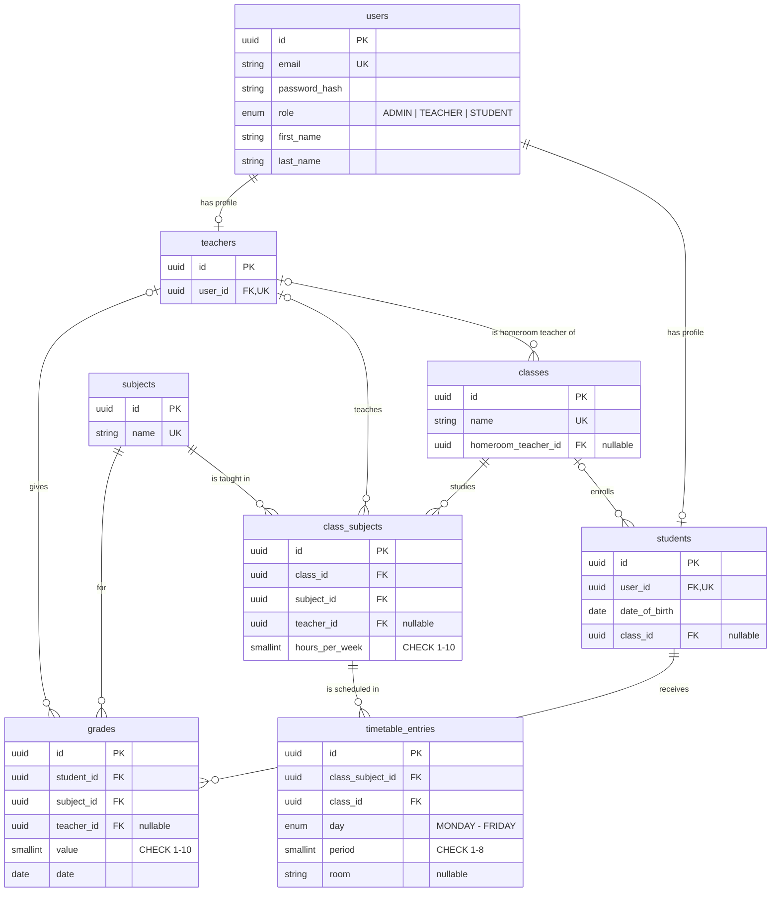

# School Management System

A full-stack web application for managing students, teachers, classes and grades, with role-based access for **Administrators**, **Teachers** and **Students**.

> Work in progress. This README grows with every feature.

## Tech stack

| Layer    | Technology                                             |
| -------- | ------------------------------------------------------ |
| Backend  | NestJS 11, TypeScript (strict)                         |
| Frontend | React 19, Vite, TypeScript, Tailwind CSS 4, shadcn/ui  |
| Database | PostgreSQL 16 (Docker), Prisma 7 ORM                   |
| Tooling  | ESLint + Prettier (API), Oxlint + Prettier (web), Jest |

## Project structure

```
.
├── backend/             NestJS REST API
├── frontend/            React single-page app
├── docker-compose.yml   PostgreSQL for local development
└── README.md
```

## Prerequisites

- Node.js 20+ (developed on Node 24 LTS)
- Docker Desktop

## Getting started

**1. Start the database**

```bash
docker compose up -d
```

**2. Set up and start the API** (http://localhost:3000/api)

```bash
cd backend
cp .env.example .env
npm install          # also generates the Prisma client
npm run db:migrate   # creates the tables
npm run db:seed      # fills the database with demo data
npm run start:dev
```

**3. Start the frontend** (http://localhost:5173)

```bash
cd frontend
npm install
npm run dev
```

In development, Vite proxies every `/api` request to the backend, so the frontend and the API behave as if they share the same origin.

## Test credentials

All seeded accounts use the password **`Password123!`**.

| Role          | Email                 | Notes                                                            |
| ------------- | --------------------- | ---------------------------------------------------------------- |
| Administrator | `admin@school.test`   | Full access                                                      |
| Teacher       | `teacher@school.test` | Teaches Mathematics in 9A, 9B and 10A, homeroom teacher of 9A    |
| Student       | `student@school.test` | Enrolled in 9A, has grades in every subject and a full timetable |

The seed also creates 9 more teachers (each teaching one subject), 60 more students (2 of them not assigned to any class), the teaching assignments of every class, a conflict-free weekly timetable and about 1,500 grades. The data is generated with a fixed seed, so it is identical on every run. Running `npm run db:seed` again resets the database to this state.

## Database

A full-size picture of the schema is in [`docs/database-schema.png`](docs/database-schema.png).



**Design decisions**

- **One `users` table for authentication, separate profile tables per role.** Login, password hashing and role checks live in one place, while student- and teacher-specific data stays in its own table.
- **Subjects are a table, not free text.** This keeps names consistent ("Math" vs "Mathematics") so per-subject averages are correct. It also makes the Excel import reliable.
- **Homeroom teacher vs. subject teachers.** The requirement "each class has one teacher" is modelled as the class's homeroom teacher (`classes.homeroom_teacher_id`, _diriginte_). Who teaches what lives in `class_subjects`: one row per class and subject, with the teacher and the number of hours per week. This is what a real school timetable is built from.
- **Grading permissions follow the teaching assignments.** A teacher can grade a student only in a subject they teach in that student's class. `grades.teacher_id` records who gave the grade, so a teacher can only edit their own grades.
- **The timetable is protected by the database, not only by the API.** `timetable_entries` has a unique constraint on `(class_id, day, period)`, so a class can never have two lessons at the same time. `class_id` is a copy of the class from `class_subjects`, kept consistent by a composite foreign key on `(class_subject_id, class_id)`. Teacher double-booking depends on who teaches the subject, which can change, so it is checked in the service layer.
- **UUID primary keys**, so IDs in URLs can't be guessed or enumerated.
- **Value ranges are enforced twice:** in the API validation and with database `CHECK` constraints (grade 1-10, period 1-8, hours per week 1-10).
- **Averages are computed, never stored**, so they can never get out of sync with the grades. As in Romanian schools, each subject gets its own average, and the overall average is the mean of the subject averages.
- **The timetable uses periods (1st to 8th lesson), not clock times.** That is how school timetables are read, and it keeps the overlap rules simple.

**What happens on delete**

| Deleted | Effect                                                                                 |
| ------- | -------------------------------------------------------------------------------------- |
| Student | Their grades are deleted too                                                           |
| Teacher | Their classes lose the homeroom teacher, their subjects become vacant, grades are kept |
| Class   | Its students become unassigned, its teaching assignments and timetable are deleted     |
| Subject | Blocked while it is taught in a class or has grades (`409 Conflict`)                   |

## Useful scripts

| Where    | Command              | What it does                                  |
| -------- | -------------------- | --------------------------------------------- |
| backend  | `npm run start:dev`  | API with hot reload                           |
| backend  | `npm run db:migrate` | Apply migrations (and create new ones in dev) |
| backend  | `npm run db:seed`    | Reset the data to the demo dataset            |
| backend  | `npm run db:reset`   | Drop everything and re-run all migrations     |
| backend  | `npm run db:studio`  | Prisma Studio, a GUI for browsing the data    |
| backend  | `npm run lint`       | ESLint (type-aware)                           |
| backend  | `npm run typecheck`  | TypeScript check, no output                   |
| backend  | `npm test`           | Unit tests                                    |
| backend  | `npm run test:e2e`   | End-to-end tests (needs the database running) |
| frontend | `npm run dev`        | Vite dev server                               |
| frontend | `npm run lint`       | Oxlint                                        |
| frontend | `npm run build`      | Type check + production build                 |

## Environment variables

The API validates its environment on startup and refuses to start if something is missing or invalid. See [`backend/.env.example`](backend/.env.example).
