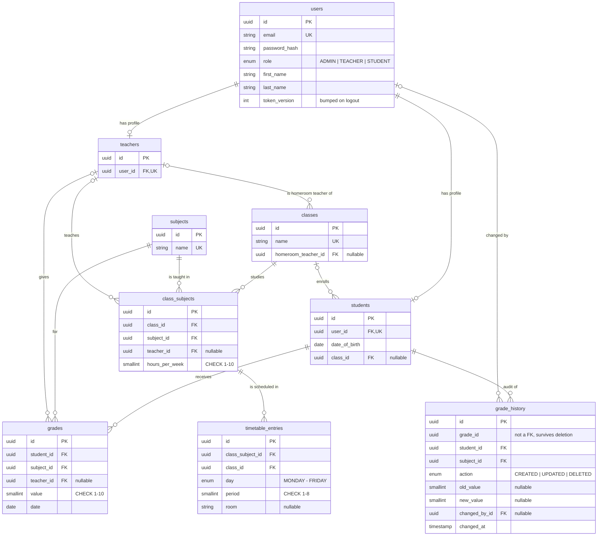

# School Management System

A full-stack web application for managing students, teachers, classes and grades, with role-based access for **Administrators**, **Teachers** and **Students**.

> Work in progress. This README grows with every feature.

## Tech stack

| Layer    | Technology                                             |
| -------- | ------------------------------------------------------ |
| Backend  | NestJS 11, TypeScript (strict)                         |
| Frontend | React 19, Vite, TypeScript, Tailwind CSS 4, shadcn/ui  |
| Database | PostgreSQL 16 (Docker), Prisma 7 ORM                   |
| Tooling  | ESLint + Prettier (API), Oxlint + Prettier (web), Jest |

## Project structure

```
.
├── backend/             NestJS REST API
│   ├── prisma/          Schema, migrations and seed
│   └── src/             Feature modules (auth, students, teachers, classes, ...)
├── frontend/            React single-page app
├── docs/                Schema picture, Bruno and Postman collections
├── docker-compose.yml   PostgreSQL for local development
└── README.md
```

## Prerequisites

- Node.js 20+ (developed on Node 24 LTS)
- Docker Desktop

## Getting started

**1. Start the database**

```bash
docker compose up -d
```

**2. Set up and start the API** (http://localhost:3000/api)

```bash
cd backend
cp .env.example .env
npm install          # also generates the Prisma client
npm run db:migrate   # creates the tables
npm run db:seed      # fills the database with demo data
npm run start:dev
```

**3. Start the frontend** (http://localhost:5173)

```bash
cd frontend
npm install
npm run dev
```

In development, Vite proxies every `/api` request to the backend, so the frontend and the API behave as if they share the same origin.

## Test credentials

All seeded accounts use the password **`Password123!`**.

| Role          | Email                 | Notes                                                            |
| ------------- | --------------------- | ---------------------------------------------------------------- |
| Administrator | `admin@school.test`   | Full access                                                      |
| Teacher       | `teacher@school.test` | Teaches Mathematics in 9A, 9B and 10A, homeroom teacher of 9A    |
| Student       | `student@school.test` | Enrolled in 9A, has grades in every subject and a full timetable |

The seed also creates 9 more teachers (each teaching one subject), 60 more students (2 of them not assigned to any class), the teaching assignments of every class, a conflict-free weekly timetable and about 1,500 grades. The data is generated with a fixed seed, so it is identical on every run. Running `npm run db:seed` again resets the database to this state.

## Database

A full-size picture of the schema is in [`docs/database-schema.png`](docs/database-schema.png).



**Design decisions**

- **One `users` table for authentication, separate profile tables per role.** Login, password hashing and role checks live in one place, while student- and teacher-specific data stays in its own table.
- **Subjects are a table, not free text.** This keeps names consistent ("Math" vs "Mathematics") so per-subject averages are correct. It also makes the Excel import reliable.
- **Homeroom teacher vs. subject teachers.** The requirement "each class has one teacher" is modelled as the class's homeroom teacher (`classes.homeroom_teacher_id`, _diriginte_). Who teaches what lives in `class_subjects`: one row per class and subject, with the teacher and the number of hours per week. This is what a real school timetable is built from.
- **Grading permissions follow the teaching assignments.** A teacher can grade a student only in a subject they teach in that student's class. `grades.teacher_id` records who gave the grade, so a teacher can only edit their own grades.
- **The timetable is protected by the database, not only by the API.** `timetable_entries` has a unique constraint on `(class_id, day, period)`, so a class can never have two lessons at the same time. `class_id` is a copy of the class from `class_subjects`, kept consistent by a composite foreign key on `(class_subject_id, class_id)`. Teacher double-booking depends on who teaches the subject, which can change, so it is checked in the service layer.
- **UUID primary keys**, so IDs in URLs can't be guessed or enumerated.
- **Value ranges are enforced twice:** in the API validation and with database `CHECK` constraints (grade 1-10, period 1-8, hours per week 1-10).
- **Averages are computed, never stored**, so they can never get out of sync with the grades. As in Romanian schools, each subject gets its own average, and the overall average is the mean of the subject averages.
- **Every grade change is audited** in `grade_history`, written in the same transaction as the change (see [Grades and averages](#grades-and-averages)).
- **The timetable uses periods (1st to 8th lesson), not clock times.** That is how school timetables are read, and it keeps the overlap rules simple.

**What happens on delete**

| Deleted | Effect                                                                                 |
| ------- | -------------------------------------------------------------------------------------- |
| Student | Their grades and grade history are deleted too                                         |
| Teacher | Their classes lose the homeroom teacher, their subjects become vacant, grades are kept |
| Class   | Its students become unassigned, its teaching assignments and timetable are deleted     |
| Subject | Blocked while it is taught in a class or has grades (`409 Conflict`)                   |

## API documentation

- **Swagger UI:** http://localhost:3000/api/docs (raw OpenAPI JSON at `/api/docs-json`). Log in with `POST /api/auth/login`, click **Authorize** and paste the `accessToken`.
- **Bruno:** open the folder [`docs/bruno`](docs/bruno) with **Open Collection**. Run one of the **Login as ...** requests first: it saves the token, and every other request uses it automatically.
- **Postman:** import [`docs/postman/school-management.postman_collection.json`](docs/postman/school-management.postman_collection.json). It works the same way.

### Endpoints

All endpoints are under `/api`. "Teacher (own)" means a teacher only sees the classes they teach or are homeroom teacher of; any other class returns `403`.

| Method | Path                                | Access                                    | Description                                                            |
| ------ | ----------------------------------- | ----------------------------------------- | ---------------------------------------------------------------------- |
| GET    | `/health`                           | Public                                    | API and database status                                                |
| POST   | `/auth/login`                       | Public                                    | Log in, returns a JWT (max 5 attempts/min)                             |
| GET    | `/auth/me`                          | Any logged-in                             | The current user with their role and profile                           |
| POST   | `/auth/logout`                      | Any logged-in                             | Log out: revokes every token of the user (all devices)                 |
| GET    | `/students`                         | Admin                                     | List students (paginated, search, class filter)                        |
| POST   | `/students`                         | Admin                                     | Create a student account, optionally in a class                        |
| GET    | `/students/:id`                     | Admin                                     | Student details                                                        |
| PATCH  | `/students/:id`                     | Admin                                     | Update a student, move or unassign, reset password                     |
| DELETE | `/students/:id`                     | Admin                                     | Delete a student and their grades                                      |
| GET    | `/teachers`                         | Admin                                     | List teachers (paginated, search)                                      |
| POST   | `/teachers`                         | Admin                                     | Create a teacher account                                               |
| GET    | `/teachers/:id`                     | Admin                                     | Teacher details, homeroom classes and subjects                         |
| PATCH  | `/teachers/:id`                     | Admin                                     | Update a teacher, reset password                                       |
| DELETE | `/teachers/:id`                     | Admin                                     | Delete a teacher (their grades are kept)                               |
| GET    | `/classes`                          | Admin, Teacher (own)                      | List classes (paginated, natural order 9A → 12A)                       |
| POST   | `/classes`                          | Admin                                     | Create a class                                                         |
| GET    | `/classes/:id`                      | Admin, Teacher (own)                      | Class details with subjects and teachers                               |
| PATCH  | `/classes/:id`                      | Admin                                     | Rename, change homeroom teacher                                        |
| DELETE | `/classes/:id`                      | Admin                                     | Delete a class (students become unassigned)                            |
| GET    | `/classes/:id/students`             | Admin, Teacher (own)                      | Students enrolled in the class                                         |
| POST   | `/classes/:id/students`             | Admin                                     | Assign several students to the class at once                           |
| DELETE | `/classes/:id/students/:studentId`  | Admin                                     | Remove a student from the class                                        |
| GET    | `/subjects`                         | Any logged-in                             | List subjects                                                          |
| GET    | `/subjects/:id`                     | Any logged-in                             | Subject details                                                        |
| POST   | `/subjects`                         | Admin                                     | Create a subject                                                       |
| PATCH  | `/subjects/:id`                     | Admin                                     | Rename a subject                                                       |
| DELETE | `/subjects/:id`                     | Admin                                     | Delete a subject (blocked while in use: `409`)                         |
| POST   | `/classes/:id/subjects`             | Admin                                     | Add a subject to a class, with its teacher and weekly hours            |
| PATCH  | `/class-subjects/:id`               | Admin                                     | Change the teacher or the weekly hours (checked against the timetable) |
| DELETE | `/class-subjects/:id`               | Admin                                     | Remove a subject from a class with its lessons (grades are kept)       |
| GET    | `/classes/:id/timetable`            | Admin, Teacher (own), Student (own class) | Weekly timetable of a class                                            |
| GET    | `/teachers/:id/timetable`           | Admin                                     | Weekly timetable of a teacher                                          |
| GET    | `/timetable/me`                     | Teacher, Student                          | My lessons (teacher) or my class timetable (student)                   |
| POST   | `/classes/:id/timetable`            | Admin                                     | Add a lesson (409 on any conflict)                                     |
| PATCH  | `/timetable-entries/:id`            | Admin                                     | Move a lesson to another slot or room                                  |
| DELETE | `/timetable-entries/:id`            | Admin                                     | Remove a lesson                                                        |
| GET    | `/grades`                           | Admin, Teacher (own)                      | List grades (paginated, filter by class, subject, student)             |
| POST   | `/grades`                           | Admin, Teacher (own)                      | Give a grade (teachers: only their subject in that class)              |
| PATCH  | `/grades/:id`                       | Admin, Teacher (own grades)               | Change the value or date of a grade                                    |
| DELETE | `/grades/:id`                       | Admin, Teacher (own grades)               | Delete a grade (kept in the history)                                   |
| GET    | `/grades/:id/history`               | Admin                                     | Who created, changed or deleted a grade, and when                      |
| GET    | `/grades/me`                        | Student                                   | My grades, subject averages and overall average                        |
| GET    | `/students/:id/grades`              | Admin, Teacher (own)                      | A student's grades and averages                                        |
| GET    | `/classes/:id/gradebook?subjectId=` | Admin, subject teacher, homeroom teacher  | All students of a class with their grades in one subject               |

### Conventions

- **Pagination:** list endpoints accept `page`, `pageSize` (max 100), `sort`, `order` (`asc`/`desc`) and `search`, and return `{ data, meta: { page, pageSize, total, totalPages } }`.
- **Errors** always have the same shape:

  ```json
  {
    "statusCode": 404,
    "error": "Not Found",
    "message": "Student not found",
    "path": "/api/students/0b39a733-7b2b-45e6-9d19-7938ad3af0b6",
    "timestamp": "2026-10-20T10:00:00.000Z"
  }
  ```

  `message` is a list for validation errors. Status codes: `400` invalid input (including malformed ids), `401` missing or invalid token, `403` not allowed, `404` not found, `409` conflict (duplicate email or name, resource still in use), `429` too many login attempts.

## Timetable rules

Every lesson added or moved is checked, and each rule has a clear `409` message:

| Rule                                                                                | Example message                                                       |
| ----------------------------------------------------------------------------------- | --------------------------------------------------------------------- |
| A class has at most one lesson per slot                                             | `9A already has Physics on Monday, period 2`                          |
| A teacher can't be in two classes at once                                           | `Mihai Ionescu already teaches 10A on Monday, period 2`               |
| A subject can't exceed its weekly hours                                             | `Mathematics already has 4/4 hours scheduled in 9A`                   |
| Weekly hours can't drop below what is scheduled                                     | `Mathematics has 5 lessons in the 9A timetable. Remove 1 of them ...` |
| Changing a subject's teacher requires the new teacher to be free at all its lessons | (same as the teacher rule)                                            |

The checks and the write run in one **serializable** transaction, so two admins editing the timetable at the same moment can't both pass the checks and create a conflict; one of them gets a `409` and can retry. The class rule is also guaranteed by a unique index in the database.

## Grades and averages

**Who can do what**

- A teacher can grade a student only in a subject they teach **in that student's class** (from the teaching assignments). Anything else is `403` with a message such as `You don't teach Physics in 9A`.
- A teacher can change or delete only the grades **they gave**. The admin can manage every grade; a grade the admin gives is attributed to the subject's teacher, and the history records that the admin entered it.
- The homeroom teacher can see every subject of their class (gradebook, student reports) but still only grades their own subject.
- A student only sees their own grades.

**Averages, as in Romanian schools** (`src/grades/averages.ts`, fully unit-tested)

- Subject average: mean of the grades with two decimals, truncated, then rounded to a whole grade: `9.50` becomes `10`, `9.49` becomes `9`. Both values are returned (`average`, `roundedAverage`).
- Overall average: mean of the **rounded** subject averages, with two decimals, truncated. It is `null` until every subject has at least one grade.
- Minimum number of grades per subject: weekly hours + 1. Reports show `minimumGrades` and `hasMinimumGrades` for each subject.
- Averages are computed with integer arithmetic (hundredths), so floating point can never turn `9.5` into `9.4999`.

**Audit log**

Every grade change writes a row in `grade_history` (who, when, action, old and new value and date) **in the same transaction** as the change itself, so a grade can never change without a trace. The history references the grade by id without a foreign key, so it survives when the grade is deleted.

## Authentication and authorization

- **Login** with email and password returns a signed JWT (`Authorization: Bearer <token>`), valid for 1 hour by default. The token only contains the user id and role.
- **Every route is protected by default.** A global guard requires a valid token everywhere; public routes are explicitly marked with `@Public()`. A new endpoint can't be left unprotected by accident.
- **Roles** are checked by a second global guard, driven by the `@Roles(...)` decorator. Finer rules (for example "a teacher can only grade their own classes") are enforced in the services, because they depend on the data.
- **The user is re-loaded on every request**, so deleting a user or changing their role takes effect immediately, not when the token expires.
- **Logout really ends the session.** A JWT can't be "deleted" on the server, so every user has a `token_version` and every token carries the version it was issued with. `POST /auth/logout` increments it, and the guard rejects any token with an older version. A password reset by the admin does the same, so old sessions can't outlive a changed password. The trade-off: logout ends the sessions on all devices.
- **Passwords** are hashed with bcrypt (unique salt per user). Login failures always return the same message (`Invalid email or password`), and an unknown email still runs a bcrypt comparison, so neither the message nor the response time reveals which emails exist.
- **Brute-force protection:** login is limited to 5 attempts per minute per IP (all other routes: 120 per minute).
- **Input validation:** every request body is validated with DTOs; unknown fields are rejected.

## Useful scripts

| Where    | Command              | What it does                                  |
| -------- | -------------------- | --------------------------------------------- |
| backend  | `npm run start:dev`  | API with hot reload                           |
| backend  | `npm run db:migrate` | Apply migrations (and create new ones in dev) |
| backend  | `npm run db:seed`    | Reset the data to the demo dataset            |
| backend  | `npm run db:reset`   | Drop everything and re-run all migrations     |
| backend  | `npm run db:studio`  | Prisma Studio, a GUI for browsing the data    |
| backend  | `npm run lint`       | ESLint (type-aware)                           |
| backend  | `npm run typecheck`  | TypeScript check, no output                   |
| backend  | `npm test`           | Unit tests                                    |
| backend  | `npm run test:e2e`   | End-to-end tests (needs the database running) |
| frontend | `npm run dev`        | Vite dev server                               |
| frontend | `npm run lint`       | Oxlint                                        |
| frontend | `npm run build`      | Type check + production build                 |

## Environment variables

The API validates its environment on startup and refuses to start if something is missing or invalid. See [`backend/.env.example`](backend/.env.example).

## What I would do with more time

- **Refresh tokens** in an httpOnly cookie, so the access token can be short-lived (minutes) without logging users out every hour.
- **Per-device logout**: store a session id (`jti`) per login and revoke only that one, instead of all sessions of the user.
